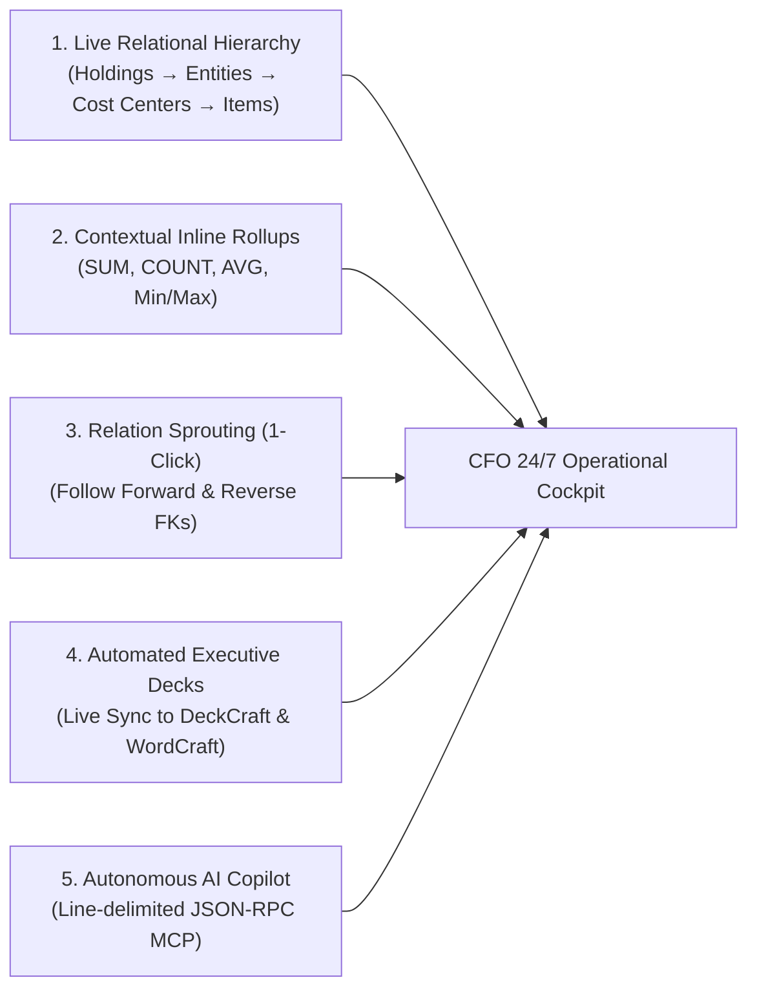

# The Executive & CFO 24/7 Relational Cockpit
## How DatabaseCraft’s Relational Canvas Replaces Spreadsheet Chaos with Continuous Financial Intelligence

> **Target Audience**: Chief Financial Officers (CFOs), Financial Controllers, Operations Directors, and Executive Decision Makers.  
> **System Port**: `14113` | **Storage**: Local-First `.dbcraft` (SQLite WAL) | **Desktop Engine**: Pure-Rust GPU Canvas (`egui`)

---

## 1. Executive Summary: The $35/Month Paradox

Modern finance departments run on relational data—ERP databases, billing tables, Stripe ledgers, customer records, and vendor catalogs. Yet financial leaders spend dozens of hours every month wrestling with **"Spreadsheet Hell"**:
* Formulas that break when a row is inserted.
* VLOOKUP / XLOOKUP spaghetti trying to connect orders to customers or invoices to entities.
* **Cartesian product explosion**: joining two tables in standard SQL tools turns 10 customers with 5 orders each into 50 duplicate rows, destroying readability.
* Static monthly PowerPoint slides that are obsolete the moment they are presented to the board.

Tools like **Ultorg** proved that the **Relational Canvas** (developed at MIT CSAIL by Dr. Eirik Bakke) is the answer: displaying plural, hierarchical relationships (*Parent Company* $\to$ *Cost Centers* $\to$ *Invoices* $\to$ *Line Items*) directly nested in an interactive spreadsheet layout without row duplication. However, Ultorg locks this capability behind a **\$35/user/month proprietary subscription** that cannot be automated, cannot run offline in secure local vaults, and remains siloed from publishing pipelines.

**DatabaseCraft** brings this paradigm to life in pure, zero-panic Rust:
1. **Always-On (24/7) Desktop Cockpit**: Lightweight, zero memory leaks, sub-millisecond local execution, running silently on an executive's second monitor.
2. **True Non-1NF Relational Perspectives**: Deep hierarchical nesting without Cartesian row multiplication.
3. **Live Contextual Rollups**: Real-time inline aggregations for Gross Burn, Cash Runway, Net Margin, and AR Aging.
4. **Instant Board Sync**: Pushes live hierarchical tables directly into **DeckCraft** (pitch decks) and **WordCraft** (investor letters).
5. **Autonomous AI Financial Copilot**: Exposes the entire relational canvas over Model Context Protocol (`MCP 2024-11-05`) for natural language executive queries.

---

## 2. The Relational Canvas vs. Traditional Tools

```
+---------------------------------------------------------------------------------------------------------------+
|                               DATABASECRAFT 24/7 EXECUTIVE FINANCIAL PERSPECTIVE                              |
+----------------------------------------------------+--------------------------+-------------------------------+
| ENTITY / SUBSIDIARY (Parent Table)                 | INVOICES (Nested 1:N)    | EXPENSE ITEMS (Child 1:N)     |
| Code | Entity Name         | Domicile | Status     | Inv #    | Due Date  | Stat | SKU/Desc  | Cat   | Amount   |
+------+---------------------+----------+------------+----------+-----------+------+-----------+-------+----------+
| US01 | Storytold Media LLC | Delaware | Active     | INV-4011 | 2026-11-30| Open | GPU Cloud | R&D   | $12,450  |
|      |                     |          |            |          |           |      | Fiber ISP | Ops   |    $850  |
|      | ∑ Cash Position:    $4,850,200 |            +----------+-----------+------+-----------+-------+----------+
|      | ∑ Monthly Burn:       $184,200 |            | INV-4019 | 2026-12-15| Open | Retainer  | Legal |  $5,000  |
+------+---------------------+----------+------------+----------+-----------+------+-----------+-------+----------+
| EU02 | Storytold GmbH      | Vienna   | Active     | INV-8820 | 2026-11-20| Paid | Studio Le | CapEx | $18,200  |
|      | ∑ Cash Position:    €1,920,400 |            |          |           |      | Acous Pan | Audio |  $3,400  |
+------+---------------------+----------+------------+----------+-----------+------+-----------+-------+----------+
```

### Strategic Comparison Matrix
| Dimension | Microsoft Excel / Google Sheets | Traditional SQL GUIs (DBeaver, DataGrip) | Ultorg | **DatabaseCraft** |
|---|---|---|---|---|
| **Plural Relationships (1:N, M:N)** | Requires complex VLOOKUPs or manual flattening | Severe row duplication across joins (Cartesian blowup) | Native nested sub-tables | **Native nested sub-tables via SQLite JSON compiler** |
| **Data Integrity** | Brittle; unconstrained cells easily corrupted | Strict relational schema | Strict relational schema | **Strict ACID SQLite WAL + Foreign Key enforcement** |
| **Resource Footprint** | Bloated Electron/Web or heavy Office runtime | Heavy JVM runtime (hundreds of MBs) | Heavy desktop client | **Pure Rust (`egui`); sub-30MB RAM; zero WebView2** |
| **Continuous 24/7 Run** | Risk of background crashes & locking | Disconnects on idle timeouts | Proprietary desktop binary | **Designed for 24/7 desktop daemon execution** |
| **Cost** | Part of O365 / SaaS | Free or $199/seat | **$35 / month / user ($420/yr)** | **100% Free & Open-Source (MIT/Apache-2.0)** |
| **Executive Publishing** | Manual copy-paste into PowerPoint/Word | Manual CSV export | Static print/PDF export | **Direct live push into DeckCraft & WordCraft** |
| **Agent / AI Integration** | External add-ins | None / rudimentary | Closed / proprietary | **Native MCP stdio (`2024-11-05`) + TCP Port `14113`** |

---

## 3. The 5 Executive Pillars of the CFO Cockpit



### 1. Live Relational Hierarchy (Non-1NF Views)
Instead of flattening complex relationships into repetitive rows, DatabaseCraft uses SQLite 3.38+ JSON aggregation functions (`json_group_array(json_object(...))`) to compile nested relational ASTs. A CFO can look at an operating subsidiary and see every active vendor contract and line-item expense nested directly within its visual row context.

### 2. Contextual Inline Financial Rollups
Any child collection can be summarized inline directly in the parent entity header:
- **`SUM(invoices.amount)`**: Instant total accounts payable per subsidiary.
- **`COUNT(DISTINCT employees.id)`**: Real-time headcount rollups across departments.
- **`AVG(deal_size.arr)`**: Average Contract Value (ACV) per sales region.
Because these rollups are compiled directly into the underlying SQL query, calculations are atomic, zero-overhead, and immune to spreadsheet formula corruption.

### 3. Relation Sprouting (`Ctrl+K` & Quick-Pills)
The CFO never needs to write `JOIN ... ON ...`. DatabaseCraft inspects both forward foreign keys ($N:1$, e.g. *Invoice* $\to$ *Vendor*) and reverse foreign keys ($1:N$, e.g. *Vendor* $\to$ *All Historical Invoices*). With a single click on a **`+ ⤹ Sprout: invoices (1:N)`** button, the sub-table blooms directly inside the view.

### 4. Direct Cross-Craft Publishing to the Board
During board meetings or executive reviews, the numbers in the slide deck must match the ledger to the cent:
* **DeckCraft**: Relational perspectives format automatically into KPI summary slides and waterfall tables.
* **WordCraft**: Contract terms, billing schedules, and board resolutions pull variable fields directly from the verified perspective.

### 5. Autonomous AI Financial Analyst via MCP
DatabaseCraft ships with a built-in Model Context Protocol server (`databasecraft-cli mcp`). The CFO or executive assistant can prompt Claude, Gemini, or local models:
> *"Show me all vendor invoices over \$10,000 for Q3 where payment is still pending, grouped by subsidiary."*

The model dispatches `canvas_query` or `canvas_compile` over stdio or control port `14113` and streams back structured executive answers instantly.

---

## 4. Operational Playbook: Running DatabaseCraft 24/7

### 4.1 Headless Background Service vs. Dedicated Display
DatabaseCraft is designed to run in two concurrent planes:
1. **Plane 1 (UI Plane)**: Native GPU-accelerated desktop window (`databasecraft.exe`) pinned to a secondary monitor or executive dashboard display.
2. **Plane 2 (Control Plane)**: Local TCP listener on registered port `14113` handling continuous MCP calls, health checks, and cross-craft merge events without UI lag.

### 4.2 Quickstart for the Financial Operator

```powershell
# 1. Seed or connect to your company ledger (e.g., Stripe mirror / ERP blueprint)
cargo run -p databasecraft-mcp -- construct --blueprint billing --db company_finances.db

# 2. Inspect forward and reverse financial relationships
cargo run -p databasecraft-mcp -- schema-relations --table customers --db company_finances.db

# 3. Launch the 24/7 executive desktop canvas
cargo run -p databasecraft-app -- --file company_finances.db --control 14113
```

### 4.3 Navigating the Canvas Interface
1. **Open Table**: Select `customers`, `invoices`, or `entities` from the left sidebar.
2. **Switch to Perspective**: Click **`✨ Open in Relational Canvas`** or switch to the **`✨ Relational Canvas`** tab.
3. **Sprout Relations**: Click any blue pill (`+ ⤹ Sprout: orders (1:N)`) to expand nested records into the continuous spreadsheet matrix.
4. **Calibrate Visual Density**: Toggle between **`Compact`** (22px row height for dense financial analysis), **`Standard`** (28px balanced view), and **`Relaxed`** (34px executive presentation mode).
5. **Auto-Formatted Cell Formatting**: Currencies automatically render with commas and symbols (`$1,850.00`), delivery/billing statuses render as soft pill badges (`[DELIVERED]`, `[PROCESSING]`, `[PENDING]`), and dates render in tabular monospace.
6. **Add Metric Rollup**: Click **`🎛 Fields & Joins`**, choose target column (`freight` or `unit_price`), select `SUM`, enter alias (`total_revenue`), and click **`➕ Add Rollup`**.
7. **Inspect ANSI SQL**: Toggle **`⚡ View SQL`** to audit the compiled SQLite query and execution latency.

---

## 5. Security & Zero-Panic Guarantee

Executive workstations require absolute reliability and strict operational security:
* **Zero Panic Policy**: Every crate enforces `#![deny(clippy::unwrap_used)]`. Errors are handled as typed `Result<T, DatabaseCraftError>` values—the app will never crash unexpectedly on malformed data.
* **Local-First & Offline**: 100% of queries, vector embeddings, and full-text searches execute locally in-process. Financial data never touches external cloud servers or licensing gates.
* **ACID Transactions & WAL**: SQLite Write-Ahead Logging guarantees zero corruption even in the event of an abrupt power outage.
