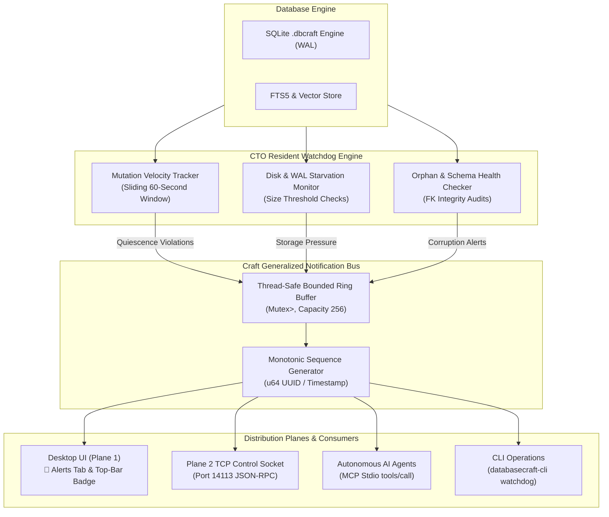

# The CTO Resident Operations Watchdog & Craft Notification Bus
## Autonomous Database Health, Quiescence Anomaly Detection, and Zero-Downtime Reliability

> **Target Audience**: Chief Technology Officers (CTOs), Resident Database Administrators, Site Reliability Engineers, and Infrastructure Leads.  
> **System Port**: `14113` | **Storage**: Local-First `.dbcraft` (SQLite WAL) | **Notification Engine**: Pure-Rust Bounded Ring Buffer

---

## 1. Executive Summary: The Silent Database Failure Mode

In modern software ecosystems, local and embedded databases (SQLite WAL files, desktop catalogs, edge nodes, local-first stores) are frequently deployed without the 24/7 observability suites (Datadog, Prometheus, PagerDuty) reserved for cloud clusters. Consequently, they succumb to **silent failure modes**:

1. **Unbounded WAL Runaway**: An uncheckpointed Write-Ahead Log quietly swells from 4 KB to hundreds of megabytes or gigabytes, degrading read performance and threatening disk starvation.
2. **Quiescent Table Churn**: Reference tables that should remain nearly static (e.g. `employees`, `roles`, `departments`, `tax_categories`, `system_config`) experience sudden high-frequency write storms due to misconfigured background workers, runaway loops, or rogue data pipelines.
3. **Foreign-Key Orphan Accumulation**: Incomplete cascade deletes or raw external imports leave dangling relationships, corrupting reporting pipelines.
4. **Isolated Alerting**: Desktop and workstation tools lack a unified notification backbone, leaving operators unaware of impending limits until an unhandled `I/O error: disk full` halts production.

**DatabaseCraft** introduces the **CTO Resident Operations Watchdog** and the **Generalized Craft Notification Bus**: a lightweight, pure-Rust, zero-panic autonomous monitoring subsystem running concurrently across CLI, desktop UI (`databasecraft-app`), and background agent MCP sessions on registered port `14113`.

---

## 2. System Architecture: The Craft Generalized Notification Bus



### 2.1 The Notification Severity Hierarchy

Every event in the bus adheres to a typed, monotonic severity model:

| Severity | Color Code | Trigger Condition | System Action |
|---|---|---|---|
| **`Info`** | Obsidian Cyan (`#108B7E`) | Normal lifecycle events (database backup, clean reindex, schema migration). | Logged to ring buffer for audit telemetry. |
| **`Warning`** | Amber Gold (`#F59E0B`) | DB/WAL size exceeds 100MB threshold, minor FK orphan detected. | Non-blocking alert; top-bar badge turns amber. |
| **`Critical`** | Rose Red (`#EF4444`) | DB/WAL size exceeds 500MB, quiescent table mutation velocity exceeds 10 writes/minute. | Top-bar badge flashes `🚨 X Alerts`; immediate remediation recommended. |
| **`Disaster`** | Magenta Flame (`#EC4899`) | SQLite page corruption, disk starvation under 50MB free space. | Immediate read-only fence; salvage clone recommended. |

---

## 3. The Quiescence Churn Anomaly Engine

### 3.1 What is Quiescent Table Poisoning?

In any enterprise schema, tables exhibit drastically different operational churn rates:
* **High-velocity transactional tables**: `orders`, `order_items`, `event_logs`, `audit_trail` legitimately experience thousands of inserts per hour.
* **Low-velocity quiescent tables**: `employees`, `roles`, `categories`, `tax_rules`, `store_locations` are modified rarely (by human HR or administrative actions).

When an automated script mistakenly updates `employees` in an unthrottled loop or misapplies an unindexed batch `UPDATE`, standard monitoring tools do not notice because the database is technically executing valid SQL.

### 3.2 The Sliding 60-Second Mutation Window

DatabaseCraft embeds a high-precision `MutationTracker` into the core engine:

```rust
pub struct MutationTracker {
    // Sliding 60-second mutation ring per table
    mutations: Mutex<HashMap<String, Vec<Instant>>>,
}
```

Whenever a mutation occurs on a table marked as quiescent (by default: `employees`, `roles`, `categories`, `departments`, `settings`), the timestamp is recorded. During every evaluation cycle:
1. Mutations older than 60 seconds are purged.
2. The remaining mutation count represents the instantaneous velocity ($V$).
3. If $V > \text{threshold}$ (default: 10 mutations/min), the Watchdog triggers a **`Critical`** alert:
   > `🚨 Quiescent Table Anomaly: High-frequency churn on quiescent table 'employees' (14 mutations in last 60s). Expected static.`

This allows the CTO or automated supervisor to kill rogue background tasks before master data is permanently overwritten.

---

## 4. Disk Starvation & WAL Envelope Monitor

SQLite Write-Ahead Logging allows concurrent reads while writes take place. However, if a long-running reader holds a read transaction open, SQLite cannot checkpoint the WAL file, causing it to grow indefinitely.

### 4.1 Proactive Warning & Critical Envelopes

The Watchdog samples filesystem metadata for both `<name>.dbcraft` and `<name>.dbcraft-wal`:

* **Warning Envelope (100 MB)**:
  `⚠️ Disk Starvation Warning: Database size is 114.2 MB (exceeds warning threshold 100 MB). Consider running VACUUM or checkpointing.`
* **Critical Envelope (500 MB)**:
  `🚨 Storage Pressure Critical: Database size is 528.0 MB (exceeds critical threshold 500 MB). Immediate vacuum or archive required.`

### 4.2 1-Click Remediation Actions

When the Watchdog raises a storage or corruption alert, the operator or AI agent can trigger atomic remediation commands directly:
1. **`Command::Vacuum`**: Rebuilds the entire database file, reclaiming unused pages and shrinking the WAL file to zero.
2. **`Command::Repair { action: "reindex" }`**: Reconstructs all schema and FTS5 indexes from scratch.
3. **`Command::Repair { action: "purge_orphans" }`**: Removes broken foreign-key records referencing non-existent parent rows.
4. **`Command::Backup { path }`**: Creates an atomic online backup snapshot into a separate directory before manual investigation.

---

## 5. Operational Playbook: CTO Watchdog in Action

### 5.1 Command Line Operations

```powershell
# 1. Run immediate watchdog audit across database health, disk, and churn
cargo run -p databasecraft-mcp -- watchdog --db production.dbcraft

# Output:
# [
#   {
#     "id": "notif-1731310123-1",
#     "timestamp": 1731310123,
#     "severity": "critical",
#     "source": "watchdog.quiescence",
#     "entity": "table:employees",
#     "message": "High-frequency churn on quiescent table 'employees' (15 mutations in last 60s). Expected static.",
#     "acknowledged": false
#   }
# ]

# 2. List all unacknowledged alerts from the bus
cargo run -p databasecraft-mcp -- notifications --unacknowledged

# 3. Acknowledge an alert once resolved
cargo run -p databasecraft-mcp -- notifications --ack notif-1731310123-1
```

### 5.2 Desktop UI: The 🚨 Alerts & Watchdog Workspace

In `databasecraft-app`, the 11th tab provides an immediate-mode operations cockpit:

1. **Top Bar Status Indicator**: Displays a calm green `🔔 Alerts` pill when clean, and a flashing red `🚨 3 Alerts` badge when warnings or critical conditions exist.
2. **Three-Column Diagnostic Cards**:
   * **Ring Buffer Metrics**: Total buffered events, unacknowledged count, buffer capacity (256).
   * **Monitored Quiescent Tables**: Active reference tables with real-time write counters.
   * **Storage Envelopes**: Current DB size, WAL size, and threshold progress bars.
3. **Incident Remediation Action Bar**:
   * **`🧹 Run VACUUM Now`**: Immediately triggers full page reclamation.
   * **`🩺 Run Doctor Diagnostic`**: Executes foreign-key integrity and index sanity checks.
   * **`📋 Review Target Table`**: Jumps directly to the Table Grid filtered to the offending entity.
4. **Interactive Alert Feed**: Filter by severity, review complete payload context, and acknowledge alerts with one click.

---

## 6. Autonomous AI Agent Integration via MCP

DatabaseCraft exposes the entire Watchdog subsystem over Model Context Protocol (`MCP 2024-11-05`):

* **`db_watchdog_check`**: Runs an instant diagnostic audit and returns structured findings.
* **`db_notifications_list`**: Returns filtered active notifications (`severity`, `unacknowledged_only`).
* **`db_notification_ack`**: Marks resolved incidents as acknowledged.

An autonomous site reliability agent running on Claude or Gemini can poll or subscribe to control port `14113`, detect quiescent churn or disk starvation, invoke `Command::Vacuum` or alert the human on-call engineer, and log the incident to Jira or Slack automatically.

---

## 7. Zero-Panic Reliability Guarantee

The Watchdog and Notification Bus run under the same strict workspace-wide `#![deny(clippy::unwrap_used, clippy::expect_used, clippy::panic)]` policy as the core query engine:
* Mutex locks use typed poisoned lock recovery or non-blocking fallbacks.
* Ring buffers are bounded (256 entries) to prevent unbounded memory growth in long-running 24/7 environments.
* Filesystem metadata failures are safely handled as typed warning events rather than crashing the process.
